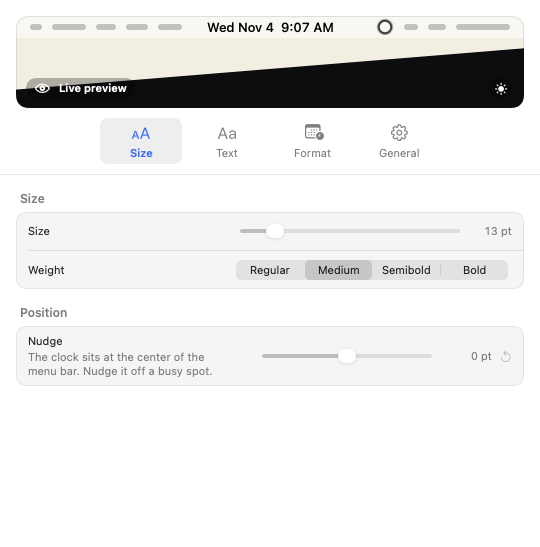

<p align="center"></p>

<h1 align="center">Fuginaut</h1>

<p align="center">
  
  
  
</p>

<p align="center"><strong>A second clock at the center of the menu bar.</strong></p>

On a wide monitor, Apple's clock sits in the far right corner, a long way from where you are
looking. Fuginaut puts a second clock at the center of the menu bar on every display, where a
glance finds it. Click it to open settings, or turn that off so clicks pass straight through.

The clock is meant for big screens. While an external display is connected, a laptop's own screen
starts with the clock off, and you can turn it on from General. A laptop on its own shows the
clock. On a screen with a notch, the clock slides beside the notch instead of hiding under it.

<p align="center"></p>

## Settings

Click the clock or the eclipse in the menu bar to open settings. Every change shows in the live
preview at the top and on the real clock right away.

- **Size:** how big and how heavy the clock reads, and a nudge off the center of the bar.
- **Text:** the font (System, Rounded, Mono, Serif, or any installed family), all caps, color,
  and a backing of a shadow or a pill to keep it readable over busy wallpaper.
- **Format:** short, long, numeric, ISO, or a custom date pattern, with switches for the weekday,
  date, 24-hour time, and seconds, plus an optional second time zone.
- **General:** which displays show the clock, whether clicking it opens settings or passes
  through, whether it stays up in full screen apps, the menu bar icon, and opening at login.

Fuginaut asks for no permissions and sends nothing anywhere.

## Install

With Homebrew:

```sh
brew install --cask dcadolph/tap/fuginaut
```

Or download `fuginaut_macos_universal.dmg` from the
[latest release](https://github.com/dcadolph/fuginaut/releases/latest), open it, and drag
Fuginaut to Applications. Releases are signed with a Developer ID and notarized by Apple.

## Verify a download

Each release carries `SHA256SUMS` with a keyless cosign signature and a build provenance
attestation.

```sh
cosign verify-blob SHA256SUMS --signature SHA256SUMS.sig --certificate SHA256SUMS.pem \
  --certificate-identity-regexp '^https://github.com/dcadolph/fuginaut/\.github/workflows/release\.yml@refs/tags/v' \
  --certificate-oidc-issuer https://token.actions.githubusercontent.com
shasum -a 256 -c SHA256SUMS --ignore-missing
gh attestation verify fuginaut_macos_universal.dmg --repo dcadolph/fuginaut
```

## Build from source

Requires macOS 14 or later and Xcode 16 or later.

```sh
make test   # run the tests
make run    # build the app, stop any running copy, and open the new one
```

## License

MIT. See [LICENSE](LICENSE).
